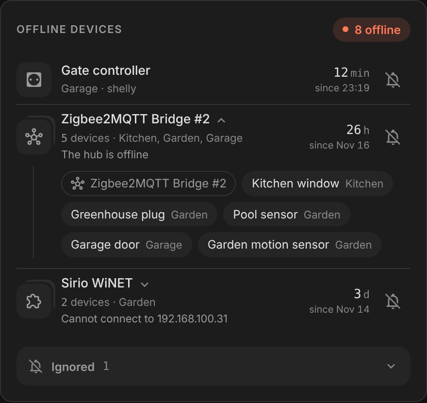
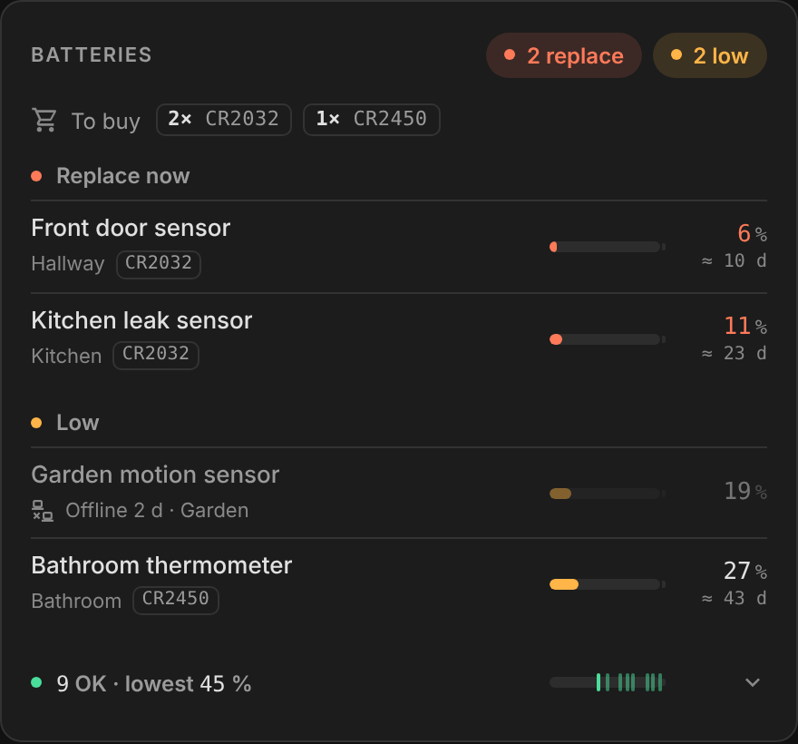

# Varta

[](https://hacs.xyz/docs/faq/custom_repositories)
[](https://github.com/RobinCK/lovelace-varta/releases/latest)

Home Assistant Lovelace cards that keep watch over the house: offline devices grouped by the hub or
integration behind them, and batteries with a replacement forecast. Devices, not entities. One
resource, the look of [Metron](https://github.com/RobinCK/lovelace-metron), every card configurable
from the visual editor or YAML.

| Offline devices                                                       | Batteries                                                         |
| --------------------------------------------------------------------- | ----------------------------------------------------------------- |
|  |  |

## Features

- **Devices, not entities.** A device is offline when all its main entities are unavailable; a
  sensor with eight unavailable entities is one row, not eight.
- **Grouped by cause.** Devices behind one hub (a Zigbee bridge, a gateway) or one failing
  integration collapse into one row with the reason from Home Assistant, e.g. “Cannot connect to
  192.168.100.20”.
- **Ignore until it is back.** A device or a whole group switched off on purpose (a pump for the
  winter, a second Zigbee network) can be ignored. It returns by itself as soon as it comes online
  again — also if it came back and dropped off while nobody looked. The list is stored in Home
  Assistant and shared by all users and devices; administrators can ignore and restore.
- **Battery forecast.** The level trend of the last 90 days gives the days left until the
  replacement level, and a jump of the level marks the last replacement. Healthy batteries fold
  into one line with the spread of their levels.
- **What to buy.** Optional battery types per model, name or entity add a shopping line:
  “2× CR2032 · 1× CR2450”.
- **Theme-aware and translated.** Follows the active theme, English and Ukrainian, any text can be
  replaced with `labels`.

## Installation

### HACS / Marketplace (recommended)

[](https://my.home-assistant.io/redirect/hacs_repository/?owner=RobinCK&repository=lovelace-varta&category=plugin)

The button opens the repository in HACS, or in the Marketplace on Home Assistant 2026.11 and newer.
Or add it manually:

- **Home Assistant 2026.11 and newer:** open **Settings → Marketplace**, choose **Add from link**,
  enter `RobinCK/lovelace-varta`, open **Varta** and click **Install**.
- **HACS:** open the menu in the top right corner, choose **Custom repositories**, add
  `https://github.com/RobinCK/lovelace-varta` with the type **Dashboard**, then search for
  **Varta** and click **Download**.

Reload the browser page afterwards (clear the cache if the cards are not found).

### Manual

1. Download `varta.js` from the [latest release](https://github.com/RobinCK/lovelace-varta/releases/latest).
2. Copy it to `<config>/www/varta.js`.
3. Go to **Settings → Dashboards → ⋮ → Resources** and add `/local/varta.js` with the type
   **JavaScript module**.

## Common options

| Option     | Type            | Default           | Description                                                                    |
| ---------- | --------------- | ----------------- | ------------------------------------------------------------------------------ |
| `title`    | string \| false | translated title  | Card title. `false` hides the header text.                                     |
| `size`     | see below       | `auto`            | Card height: `small`, `medium`, `large` or `auto` (the height of the content). |
| `language` | `en` \| `uk`    | Home Assistant UI | Language of the card texts.                                                    |
| `labels`   | map             | —                 | Override any text by its translation key, e.g. `devices.title: Offline`.       |
| `colors`   | map             | theme-aware       | `warning` (replace, offline), `caution` (low) and `ok` colors.                 |

Colors can also be set globally from a theme with `metron-warning-color`, `metron-caution-color`
and `metron-ok-color`, shared with Metron. In a light theme the colored texts are darkened for
contrast.

The sizes follow the rows of the Home Assistant sections grid like in Metron: `small` is 3 rows,
`medium` 6 and `large` 9. Both cards default to `auto`, the height of the content.

Patterns in `exclude` and `types` match a device ID, a device name, a model, a manufacturer or an
entity ID; `*` matches any text, e.g. `Sirio*` or `sensor.*_phone_battery`.

## Cards

| Card            | Type                   | What it shows                                                    |
| --------------- | ---------------------- | ---------------------------------------------------------------- |
| Offline devices | `varta-devices-card`   | Offline devices grouped by hub or integration, ignore until back |
| Batteries       | `varta-batteries-card` | Battery devices by urgency, forecast, last replacement, to buy   |

### Offline devices — `custom:varta-devices-card`

A device is offline when all its main entities (not diagnostic or configuration ones) are
`unavailable`. Devices behind the same hub become one group with the hub name, the number of
devices and whether the hub itself is offline; devices of one integration that cannot set up
become one group with its reason. Tap a group to see its devices, tap a device to open it.

The bell button ignores a row until it comes back: the card checks the history of every ignored
device and lifts the ignore as soon as any of its entities had a real state again. The ignored
list is collapsed under the rows; restore brings a row back right away.

```yaml
type: custom:varta-devices-card
exclude:
  - Samsung*TV
```

Options: `exclude` (patterns), `limit` (rows before “Show all”, `8`), `show_ignored` (`true`).

Ignoring needs an administrator; other users see the list without the buttons. The reasons of the
integrations are read from the configuration entries, which Home Assistant shows to administrators
only.

### Batteries — `custom:varta-batteries-card`

One row per device with a battery level sensor or a low battery binary sensor. Rows are grouped by
urgency: replace now, low and OK; the OK ones are collapsed into one line with the lowest level.
An offline device keeps its last known level from the statistics.

The forecast takes the daily average level of the last 90 days after the last replacement and gives
the days until the replacement level, or until the battery is empty once it is below that level; a
flat or too short history (less than 10 days) gives no forecast.

```yaml
type: custom:varta-batteries-card
warning: 30
critical: 15
exclude:
  - sensor.*_phone_battery*
  - deye*
types:
  Door and window sensor: CR1632
  Temperature and humidity sensor: CR2032
  Wireless switch*: CR2032×2
```

Options: `warning` (`30`), `critical` (`15`), `forecast` (`true`), `exclude` (patterns), `types`
(optional map from a pattern to a battery type; `×2` or `2×` sets the number of cells).

## Development

```bash
npm install
npm run build      # dist/varta.js
npm run lint
npm run typecheck
npm test
```

CI and releases run only manually from the Actions tab.

## Other Home Assistant projects

- [Metron](https://github.com/RobinCK/lovelace-metron) — Lovelace cards for energy, solar, battery, gas and money: live flows, statistics, forecasts and bills.
- [Blackout](https://github.com/RobinCK/blackout) — integration for planned and emergency power outages in Ukraine: schedules for 21 regions, the Ukrenergo grid state, outage history and dashboard cards.
- [Klimo](https://github.com/RobinCK/klimo) — add-on for room-by-room heating and cooling: heat pumps, boilers, air conditioners, heaters and circulation pumps.
- [Zroshua](https://github.com/RobinCK/zroshua) — add-on for smart irrigation: zones, schedules, weather, rain and soil sensors and a live site map.
- [Phase Pair Card](https://github.com/RobinCK/lovelace-phase-pair-card) — Lovelace card for three-phase homes: voltage and power before and after the voltage stabilizers, phase balance.
- [Deck Card](https://github.com/RobinCK/lovelace-deck-card) — adaptive container card that groups cards into segments: pills on wide screens, swipe on phones.
- [Osnova](https://github.com/RobinCK/osnova) — theme for the whole Home Assistant interface with a Ukrainian cross-stitch ornament.

## License

MIT
